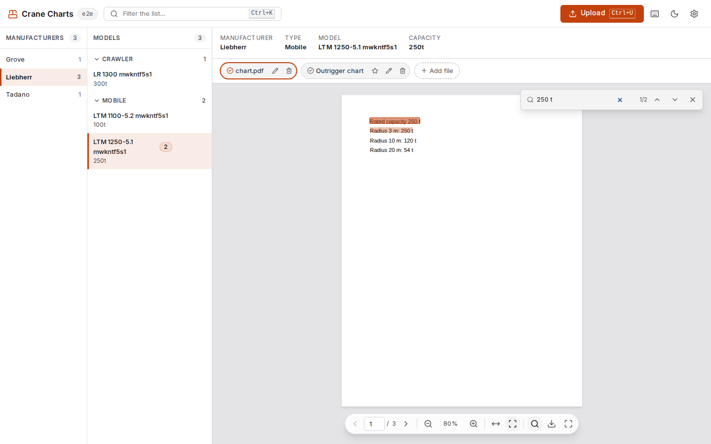

# Crane Charts

A self-hosted app for cataloguing crane load-chart PDFs. A **crane** is identified by
manufacturer, type, model, and rated capacity, and owns **one or more PDFs** (the main load
chart plus any supplementary sheets). The sidebar groups cranes hierarchically
(Manufacturer → Type → Model); the viewer renders PDFs inline with PDF.js and can **search
inside** the open document.

It runs on Node 22 (TypeScript, Express on the shared `@hhh/server` kit) with a React front end
on the shared `@hhh/ui` design system, the same platform as PhotoMapper.

Current release: see [CHANGELOG.md](CHANGELOG.md) or the GitHub Releases page · Image: `ghcr.io/huttonhomehub/crane-charts`



More in [docs/screenshots/](docs/screenshots/): dark theme, Settings, and a phone.

## Features

- **Multiple files per crane** — attach supplementary PDFs (outrigger charts, transport
  dimensions, …) to a crane; pick which one is the **main** file that opens by default.
  Rename file labels inline; a badge marks cranes with more than one file.
- **Bulk import** — drop a pile of PDFs (or multi-select in the picker) and they're grouped
  into cranes by the `Manufacturer Model (Label).pdf` filename convention. Fill Type +
  Capacity (with "apply to all"), pick each crane's primary, and import in one pass.
- **Command palette** — `Ctrl/Cmd+K` jumps to any crane by make, model, or type, or filters by
  capacity with a range query (`>=150`, `150+`) that lists everything at or above that tonnage,
  smallest-first. Opening a crane deep-links the URL (`…/#crane/<id>`) so it's shareable and
  bookmarkable.
- **In-PDF find** — `Ctrl/Cmd+F` (or `/`) searches inside the open chart, highlights matches,
  and jumps between them. Ideal for locating a radius/capacity value in a dense table.
- **Consistent data** — the make/type fields autocomplete from your existing catalogue, and a
  **merge manufacturers** tool in Settings fixes a mistyped make (e.g. "Liebherri" → "Liebherr")
  by moving all its cranes across in one click.
- **Drag-and-drop** — drop one PDF to create a crane (or add to the open one), or many to
  bulk-import. The upload dialog's picker is itself a drop target.
- **Fast catalogue** — cursor-paginated API and a virtual-scrolled sidebar handle large
  libraries without lag.
- **Themes, keyboard shortcuts, mobile drawer, fullscreen** — light and dark (following the
  system until you choose), `?` lists every shortcut, and below 900px the sidebar becomes a
  drawer.

## Deploy (Docker)

The image follows the shared HuttonHomeHub container standard: all state lives under `/config`
(the database, `uploads/` and `backups/`), and settings shared with the other apps have the same
names everywhere (`PUID`, `PGID`, `TZ`, `TRUST_PROXY`, `LOG_LEVEL`). A `docker-compose` service
(also in [deploy/compose.example.yml](deploy/compose.example.yml)):

```yaml
services:
  crane-charts:
    container_name: crane-charts
    image: ghcr.io/huttonhomehub/crane-charts:latest # or pin a version, e.g. :1.9.0
    ports:
      - 5000:5000
    environment:
      - PUID=1000
      - PGID=1000
      - TZ=Europe/London
      - TRUST_PROXY=1 # proxy hops in front (1 = nginx); 0 = no proxy
    volumes:
      - /apps/crane-charts/config:/config
    restart: unless-stopped
```

`docker-entrypoint.sh` fixes ownership of the data directories at start (only those not already
owned by `PUID`) and then runs the app as `PUID`/`PGID`, so a fresh or root-owned host directory
just works — no manual `chown`. Deploying an update is pulling the new image and recreating the
container (in Dockge, or `docker compose pull crane-charts && docker compose up -d crane-charts`);
the built files carry content hashes, so no hard-refresh is needed. Confirm the running
version with the badge in the app-bar or `curl https://<host>/version`.

**Access control.** The app has no login of its own — it is designed to sit behind a gate.
In this deployment that's **tinyauth** via an nginx `auth_request` on every path (see
[docs/remediation/risk-register.md](docs/remediation/risk-register.md), RR-001). The nginx
`location /` must forward `X-Forwarded-Proto`/`X-Forwarded-For`/`Host` for `TRUST_PROXY=1`
to work (the CSRF cookie's `Secure` flag and rate-limit keying depend on it).

**Behind Cloudflare.** With Cloudflare in front of nginx, nginx must restore the visitor's IP
before forwarding: `set_real_ip_from` for each of Cloudflare's ranges
([IPv4](https://www.cloudflare.com/ips-v4), [IPv6](https://www.cloudflare.com/ips-v6)) plus
`real_ip_header CF-Connecting-IP;`, then `proxy_set_header X-Forwarded-For $remote_addr;`.
Otherwise the one hop `TRUST_PROXY=1` trusts is a Cloudflare server, and rate limits are
keyed on Cloudflare's IP instead of the visitor's. PhotoMapper runs behind the same proxy the
same way; its [deployment doc](https://github.com/HuttonHomeHub/PhotoMapper/blob/dev/docs/DEPLOYMENT-SECURITY.md#behind-cloudflare-restore-the-real-client-ip-in-nginx)
has the full nginx snippet.

### Environment variables

Shared with every HuttonHomeHub app (same name and meaning everywhere):

| Var             | Default                | Purpose                                                                                                                                          |
| --------------- | ---------------------- | ------------------------------------------------------------------------------------------------------------------------------------------------ |
| `PUID` / `PGID` | `1000`                 | User and group the app runs as; data directories are chowned to them                                                                             |
| `TZ`            | UTC                    | Time zone for logs and timestamps, e.g. `Europe/London`                                                                                          |
| `TRUST_PROXY`   | `0`                    | Number of reverse-proxy hops in front whose `X-Forwarded-*` headers are trusted. `0` = none. Never set it higher than the real number of proxies |
| `LOG_LEVEL`     | `info`                 | `fatal`, `error`, `warn`, `info`, `debug` (also `trace`, `silent`)                                                                               |
| `DATA_DIR`      | `/config` in the image | Where all state lives; the next two default inside it                                                                                            |
| `DB_PATH`       | `$DATA_DIR/crane.db`   | SQLite database file                                                                                                                             |
| `UPLOADS_DIR`   | `$DATA_DIR/uploads`    | PDF storage directory                                                                                                                            |
| `APP_VERSION`   | `dev`                  | Release version, set from the image tag at build time                                                                                            |

Crane Charts only:

| Var                          | Default            | Purpose                                                                         |
| ---------------------------- | ------------------ | ------------------------------------------------------------------------------- |
| `MAX_UPLOAD_MB`              | `500`              | Max upload size (MB)                                                            |
| `MAX_FIELD_LEN`              | `64`               | Max characters per metadata field                                               |
| `UPLOAD_RATE` / `WRITE_RATE` | `60 per minute`    | Per-IP limits for uploads / every other change (`N per [K] second/minute/hour`) |
| `BACKUP_DIR`                 | `<db dir>/backups` | Where periodic backups are written                                              |
| `BACKUP_INTERVAL_HOURS`      | `24`               | Backup interval                                                                 |
| `BACKUP_KEEP`                | `7`                | How many backups to retain                                                      |
| `BACKUP_ENABLED`             | `1`                | Set `0` to disable the backup scheduler                                         |
| `BACKUP_INCLUDE_UPLOADS`     | `1`                | Set `0` for DB-only backups (when PDFs live on snapshotting storage)            |
| `MAX_RESTORE_MB`             | `4096`             | Max uncompressed size of a restore archive (zip-bomb guard)                     |

The old `CRANE_`-prefixed names (`CRANE_TRUST_PROXY`, `CRANE_DB`, `CRANE_UPLOAD_DIR`,
`CRANE_BACKUP_KEEP`, …) still work. Each one in use logs a one-line "deprecated" warning at
startup, naming its replacement. A new name always wins over an old one.

### Upgrading from 1.x

2.0 is a rebuild of the same app on the shared platform; the data carries over untouched. Pull
the new image and recreate the container with the same compose file. What you will notice:

- **Same data, same layout.** `crane.db` opens as it is (a `schema_migrations` table is added,
  after a `premigrate-…` copy in the backups folder), and `uploads/` is unchanged.
- **Backups made by 1.x** are renamed once at startup (`crane-backup-YYYYMMDD-HHMMSS-ffffff.zip`
  → `crane-backup-YYYYMMDD-HHMMSS.zip`) so Settings lists, restores and prunes them. They restore
  as before.
- **Theme:** 1.x was dark by default; 2.0 follows the system until you pick one with the toggle.
- **`/health`** answers `{"status":"ok","version":…}` (the shared standard), without 1.x's
  upload count. `/api/info` and `/api/backup` use the shared shapes; every crane route keeps its
  1.x JSON.
- **A page left open across the upgrade** needs a reload (the security cookie changed name).

To go back, run the 1.9 image on the same volume: it reads the database and backups as they are.

### Backups & restore

The app writes periodic **full backups** — a consistent `crane.db` snapshot plus a zip of
`uploads/` — to `BACKUP_DIR`, pruned to `BACKUP_KEEP`. The **Settings** panel (the
app-bar gear) shows backup status, a "Back up now" button, and a list of existing backups you can
download or **Restore** in place — plus an **Upload & restore** control to recover from a
downloaded zip on a fresh instance. A restore replaces the whole catalogue (database + PDFs) and
first takes a `…-prerestore.zip` safety backup, so it's reversible. (You can still restore by hand
if you prefer — `crane.db` and `uploads/` sit at the zip root.)

For real safety, point `BACKUP_DIR` at a **separate mount** (e.g. a NAS share) so a
single-disk failure doesn't take the backups with it:

```yaml
environment:
  - BACKUP_DIR=/backups
volumes:
  - /apps/crane-charts/config:/config
  - /mnt/truenas/crane-backups:/backups
```

Note: keep the _live_ `crane.db` on local/block storage — SQLite's WAL locking is unreliable
over NFS/SMB. The PDFs, being plain write-once files, are safe on a network share, so a good
split is **DB local, `UPLOADS_DIR` on a NAS**:

```yaml
environment:
  - UPLOADS_DIR=/pdfs # PDFs → NAS (the database stays in /config)
  - BACKUP_INCLUDE_UPLOADS=0 # NAS/ZFS already snapshots the PDFs
volumes:
  - /apps/crane-charts/config:/config
  - /mnt/truenas/crane-pdfs:/pdfs
```

With PDFs on storage that snapshots itself (e.g. TrueNAS/ZFS), set
`BACKUP_INCLUDE_UPLOADS=0` so backups are DB-only — small and fast — and rely on the
NAS's own snapshots for the documents.

## Develop

Everything runs in containers on the dev box (no Node installed on it). From the repo root:

```bash
# All checks, exactly as CI: typecheck, lint, format, unit tests with coverage, build, audit,
# then the end-to-end tests against the built image.
sh scripts/check.sh

# Just the end-to-end tests (optionally a filter), or new screenshots:
sh scripts/e2e.sh viewer
SCREENSHOTS=1 sh scripts/e2e.sh screenshots
```

With Node 22 installed elsewhere: `npm ci`, then `npm run server` (the API on :5000) and
`npm run dev` (Vite, proxying `/api`, `/uploads` and `/version` to it).

Architecture, invariants, and the full route/behaviour reference for contributors (and AI
assistants) live in **[CLAUDE.md](CLAUDE.md)**. Version history is in
**[CHANGELOG.md](CHANGELOG.md)**.

## Architecture (short)

One Node process. State is the `uploads/<crane_id>/` directories plus `crane.db` (SQLite:
`cranes`, `files`, `spec_events` audit log), with numbered SQL migrations in
`server/migrations/`. The server ([server/](server/)) is Express on the shared `@hhh/server` kit
(security headers with a strict CSP, CSRF, rate limits, structured logs, backups, graceful
shutdown); the front end ([src/](src/)) is React on `@hhh/ui`, built by Vite. PDF.js is loaded
on first use with a same-origin worker. Both share the API types in
[shared/api.ts](shared/api.ts).

### API

All `/api/*` endpoints return JSON; errors are uniformly `{ "error": "…" }`. Changes
(`POST`/`PUT`/`PATCH`/`DELETE`) need the `X-CSRF-Token` header matching the `hhh_csrf` cookie.

| Method   | Path                               | Purpose                                                          |
| -------- | ---------------------------------- | ---------------------------------------------------------------- |
| `GET`    | `/api/pdfs?after=<id>&limit=<n>`   | List cranes (paginated); each item has `files[]` + primary `url` |
| `GET`    | `/api/facets`                      | Makes and types in use (autocomplete, merge)                     |
| `POST`   | `/api/upload`                      | Create a crane from its first PDF (+ optional `label`)           |
| `POST`   | `/api/cranes/<id>/files`           | Attach a supplementary PDF (+ optional `label`)                  |
| `PUT`    | `/api/cranes/<id>/primary`         | Set the main file (`{file_id}`)                                  |
| `PATCH`  | `/api/cranes/<id>/files/<file_id>` | Rename a file's label                                            |
| `DELETE` | `/api/cranes/<id>/files/<file_id>` | Delete one file (last file → deletes the crane)                  |
| `PUT`    | `/api/metadata/<id>`               | Edit crane make/type/model/capacity                              |
| `DELETE` | `/api/delete/<id>`                 | Delete a whole crane                                             |
| `POST`   | `/api/merge-make`                  | Move every crane of one make onto another (`{from, into}`)       |
| `GET`    | `/api/export`                      | Download the catalogue as JSON                                   |
| `GET`    | `/api/backup`, `POST /api/backup`  | Backup status and list; back up now                              |
| `GET`    | `/api/backup/download[/<name>]`    | A fresh backup, or a listed one                                  |
| `POST`   | `/api/backup/restore`              | Restore by `{name}` or an uploaded zip                           |
| `GET`    | `/api/info`                        | How this instance is set up                                      |
| `GET`    | `/uploads/<id>/<file>`             | Serve a stored PDF (with range requests)                         |
| `GET`    | `/health`, `/version`, `/ready`    | Liveness, running version, readiness (database answers)          |

## History

Crane Charts began as a small app and was hardened by a 2026-07-06 engineering deep-dive
(all findings resolved — see [docs/remediation/](docs/remediation/)), then grew the feature
set above across v1.1–v1.9, and was rebuilt on the shared HuttonHomeHub platform for 2.0. See [CHANGELOG.md](CHANGELOG.md) for the release-by-release story
and [docs/remediation/decision-log.md](docs/remediation/decision-log.md) for the rationale
behind the notable design decisions.
